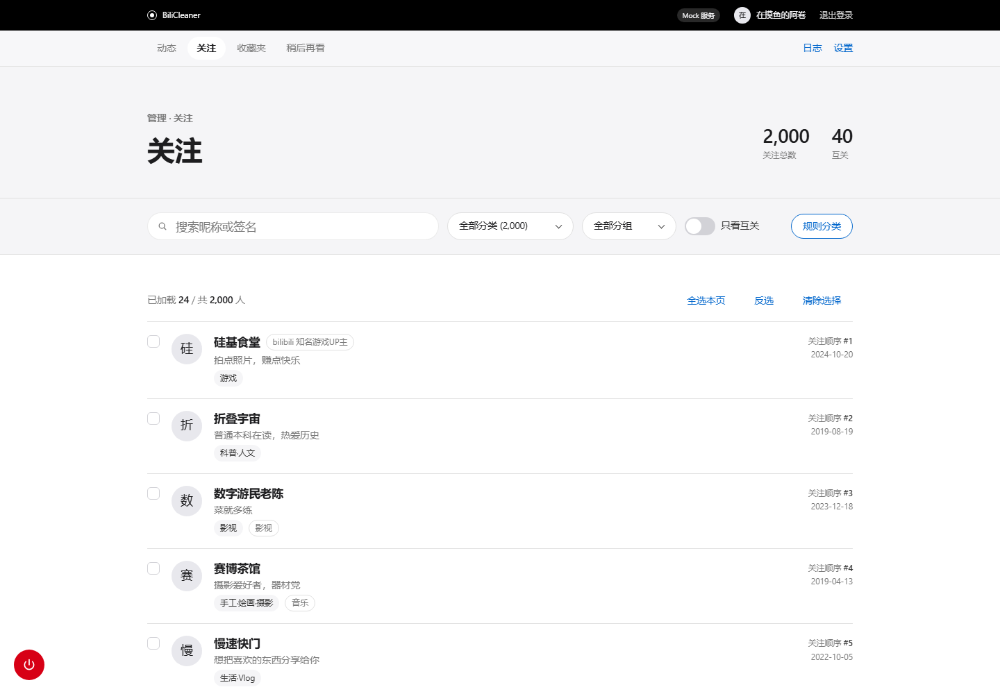
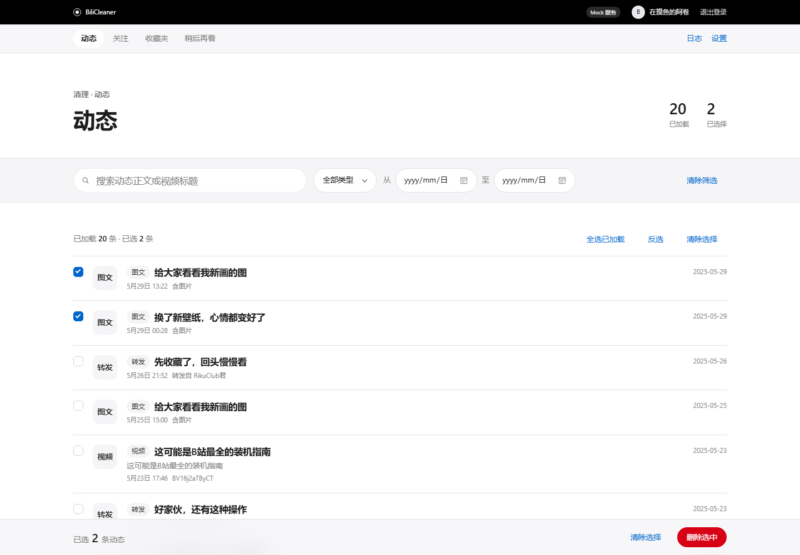
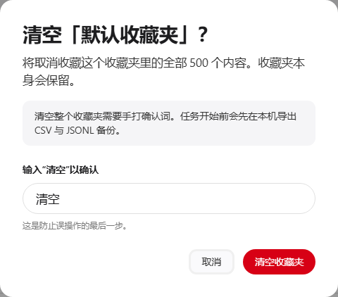

# BiliCleaner

一个跑在你自己电脑上的 B 站账号清理工具：批量取关、删动态、清空收藏夹、清空稍后再看。请求从本机直接发到 B 站，中间没有我的服务器，也没有别人的服务器。

> 版本 0.1.0。模拟数据下全链路已经跑通：185 条测试全绿，六种任务端到端完成，备份三件套正常生成，`dist\BiliCleaner.exe`（23.8 MB）也能直接跑起来。真实账号也冒烟过一次：只读接口 7/7 通过，小规模写测试（取关 6 个、删 1 条动态、清 4 条稍后再看）全部成功、备份正常。不过你的账号、网络跟我的不一样，第一次用真号还是建议先按 [docs/SMOKE-TEST.md](docs/SMOKE-TEST.md) 跑一遍只读冒烟，再动写操作。
>
> 下载：[Releases](https://github.com/Oblivionis7999/bili-cleaner/releases)（Windows exe，约 24 MB）；不想用现成的也可以自己构建，见[怎么跑](#怎么跑)。







（截图都是 `--mock` 模拟数据模式跑的，不是谁的账号。）

## 目录

- [它能干什么](#它能干什么)
- [它不能干什么](#它不能干什么)
- [为什么会有这东西](#为什么会有这东西)
- [下载](#下载)
- [怎么跑](#怎么跑)
- [扫码登录](#扫码登录)
- [限速，以及为什么这么慢](#限速以及为什么这么慢)
- [数据在哪](#数据在哪)
- [常见问题](#常见问题)
- [免责声明](#免责声明)
- [License](#license)
- [开发](#开发)

## 它能干什么

四件事：取关、删动态、清收藏夹、清稍后再看。都是删自己账号里的东西，没有别的用途。

| 功能 | 说明 | 状态 |
|---|---|---|
| 批量取关 | 按分类、分组、是否互关筛选，勾选后交给后台任务一条条取关。B 站没有批量取关接口，只能单条发 | 已实现 |
| 删动态 | 按类型（转发/图文/视频/专栏…）和关键词筛选，删自己的动态。B 站也只允许删自己的 | 已实现 |
| 清空收藏夹 | 选一个收藏夹，批量取消收藏；也可以只清"失效内容"（视频被删/下架的那些）。只清条目，不动收藏夹本身 | 已实现 |
| 清空稍后再看 | B 站有官方的一键清空接口，这个最快；同样先备份再动手 | 已实现 |
| 关注规则分类 | 21 个固定类别，按昵称、签名、认证信息、已有分组这些本地规则打标，不联网、免费 | 已实现 |
| 可选 LLM 分类 | 你自备 OpenAI 兼容接口（base_url / key / model），把昵称、签名这类公开文本发过去让模型分类。默认关闭，失败自动退回规则分类 | 已实现 |
| 扫码登录 | 走 B 站官方扫码流程，工具不碰账号密码 | 已实现 |
| 强制备份 | 任何删除类任务在发第一个写请求之前，先导出 CSV（人看）和 JSONL（完整字段）。备份失败就不许往下删 | 已实现 |
| 互关保护 | 互关的人默认从批量取关里排除（服务端还会再过滤一次），列表里单独标出来 | 已实现 |
| 暂停 / 继续 / 停止 | 任务在后台跑，随时能停。停掉不会回滚已经删掉的 | 已实现 |
| 风控冷却 | 撞上 `-352`、`-412` 这类风控就冷却 10 分钟再试同一批；连着两次不过就停掉 | 已实现 |
| 断点续跑 | 每个对象处理完写一行操作日志，进程重启后跳过已经成功的 | 已实现 |
| 本地网页界面 | 在 `127.0.0.1` 起服务，浏览器打开。浅色界面，无构建步骤、无 CDN | 已实现 |

"已实现"的意思是：在模拟数据下，从界面、接口、任务引擎到备份落盘整条链路跑通，有测试覆盖。真实账号接口也在作者账号上冒烟过（只读 7/7 + 小规模写操作），但不同账号、网络和 B 站接口变更仍可能出问题，第一次用真号请先跑只读冒烟，别一上来就清几千条。

基础设施部分：

| 已经写好的底座 | 说明 | 状态 |
|---|---|---|
| 本地数据目录 | `%APPDATA%\BiliCleaner` 下的登录态、设置、任务、日志、备份目录读写 | 已实现 |
| 登录态加密 | Windows DPAPI 加密存 Cookie，只有当前 Windows 用户能解开 | 已实现 |
| 分类与错误码常量 | 21 个分类、6 种任务类型、7 种任务状态、风控码和登录失效码的归类 | 已实现 |
| 命令行 | `bilicleaner` 或 `python -m bilicleaner`，有 `--mock`、`--port`、`--host`、`--data-dir`、`--no-browser`、`--version` | 已实现 |
| 打包脚本 | PyInstaller 单文件，产物 `dist\BiliCleaner.exe`，实测 23.8 MB | 已实现 |
| 真实账号冒烟脚本 | `scripts\smoke_real.ps1`，默认只读，写测试要显式加参数并二次确认 | 已实现（需要人工跑） |

## 它不能干什么

- **不能恢复删掉的东西。** B 站没有撤销接口。备份是给你"以后想知道删了什么"或者"想自己写脚本加回来"用的，不是一键还原。取关之后原来的关注顺序也回不来了。
- **不能绕过风控。** 这个工具的态度是"慢一点但能跑完"，不提供代理池、不做并发冲刺、不换 UA 伪装，以后也不会加。你要是嫌 2.5 秒一条慢，那这工具不适合你。
- **不能多账号。** 登录态只存一份，没有账号切换。用 `--data-dir` 给每个账号分开数据目录、再开第二个进程，理论上能凑合，但两个进程一起写同一批接口，风控只会来得更快，所以不推荐，我也没测过。
- **不是 B 站官方客户端**，不会帮你登录别人的账号，也不能清理别人的数据。
- **不保证结果。** "删成功"以 B 站返回为准，我只在本地记账。网络断了、接口改了、数据处于奇怪状态，都可能失败。

以下这些是明确不做，或者以后再说：

| 事项 | 态度 |
|---|---|
| 观看历史批量清理 | roadmap。B 站观看历史的接口比较碎，误删的影响比收藏大得多，得单独想清楚 |
| 黑名单 / 粉丝管理 | roadmap。先把关注这一侧做扎实 |
| 一键还原备份（重新关注、重新收藏） | 不做。UP 主可能已注销、视频可能已失效、关注数有上限，这个承诺我给不了 |
| macOS / Linux | roadmap。源码在其他系统上理论上能跑，但存储层会退化成 base64（只适合开发），而且没测过，别当正式支持 |
| 浏览器插件 | 不做。依赖页面 DOM，B 站前端一改就废 |
| 多账号 | 不做，理由见上 |

## 为什么会有这东西

有阵子我总觉得首页推的东西越来越陌生，点开关注列表才发现：我关注了 2132 个人。

这 2132 个人里，我能说出最近一条视频的不到一百个。剩下的是这些年攒下来的：深夜刷到的剪辑号、因为一个视频关注的、朋友的朋友、已经注销的、还有我自己都解释不了的"顺手关注"。一个个点开看，最后决定留 380 个。

手动取关到第 60 多个我就放弃了。网页一页 20 个，每个都得点两下确认，鼠标点得手腕发酸，进度还不到 3%。

然后我写了个脚本。第一版没有限速，连着发了三四百个请求，接口开始返 `-352`，接着整个账号的写操作被拦了十几分钟。换浏览器、清 cookie 都没用，后来才知道 `-412` 是 IP 那一层的东西，不是换个会话就能躲开的。

把节奏放到每条 2.5 秒、每 20 条歇一下之后，1752 个取关分了几个时段才跑完，中间冷却了几次，加起来两三个小时。后面又顺手把 141 条动态、4565 条收藏、875 条稍后再看也清了。收藏夹里一大半是"收藏了 = 看过了"的自我安慰；稍后再看更直接，最早一条是几年前加的，一次都没打开过。

中间还闹过一个笑话。我图省事，把关注关系里 `attribute` 不是 2 的都当成"已经不是好友了"，结果一百多个互关的同学被我当成"已拉黑"取关了。B 站接口里 `attribute=6` 是互关，`attribute=2` 才是单方面关注。至于拉黑，黑名单列表接口里用的是 `attribute=128`；关注关系接口里如果遇到 2 和 6 以外的值，别照抄这段自己猜，先查文档。代价是我一个个私信去道歉。

所以现在工具里 `protect_mutual` 默认开着：互关会在列表里单独标出来，而且服务端直接过滤掉，光在界面上勾没用，得去设置里关掉这个开关。

我猜有类似需求的不止我一个，就把脚本整理成了这个东西。

## 下载

从 [Releases](https://github.com/Oblivionis7999/bili-cleaner/releases) 下 `BiliCleaner.exe`（v0.1.0，Windows 10/11 x64，约 24 MB）。单文件，不用装 Python，HTML/CSS/JS 都打在里面了。

1. 下载 `BiliCleaner.exe`
2. 双击运行
3. 浏览器自动打开 `http://127.0.0.1:8770/`

下载后建议核对一下 SHA256（v0.1.0 的校验值，24,953,852 字节）：

```powershell
Get-FileHash .\BiliCleaner.exe -Algorithm SHA256
# 226B3E9AEC70829BBFA88B1016BE6947A1919DAE08E46B807FDDB7BD4CE9DDC7
```

几个提醒：

- exe 没有代码签名，Windows SmartScreen 可能提示"未知发布者"。确认文件来自上面的 Releases 页面再放行，别用别人转发的 exe。
- 单文件 exe 每次启动要解压到临时目录，第一次会慢几秒。
- 数据目录默认 `%APPDATA%\BiliCleaner`。
- 不想用现成包、或者想改代码：自己构建，见[怎么跑](#怎么跑)的源码方式和[开发](#开发)里的打包命令。

## 怎么跑

三种方式，选一种就行。exe 的下载、校验和系统要求写在上面的[下载](#下载)一节，这里补自己构建的备选和另外两种运行方式。

不管哪种方式，**第一次用真实账号之前先跑一次只读冒烟**（`docs/SMOKE-TEST.md`）：它只请求列表接口、不发写请求，能确认登录态、接口和限速都正常，再动删除。

### 方式一：exe

去 [Releases](https://github.com/Oblivionis7999/bili-cleaner/releases) 下载 `BiliCleaner.exe`，双击运行，浏览器自动打开 `http://127.0.0.1:8770/`。系统要求、SHA256 校验、SmartScreen 提醒都在[下载](#下载)那一节。

不想用现成的包，自己构建也行：`python -m pip install -e ".[dev]"` 之后跑 `.\scripts\build_exe.ps1`，产物还是 `dist\BiliCleaner.exe`。完整命令和目录说明见[开发](#开发)。

### 方式二：pipx（还没发到 PyPI）

```powershell
pipx install bilicleaner
bilicleaner
```

命令先放这，包还没传。等正式发版再补这一步，在那之前别装进系统 Python。

### 方式三：源码运行

```powershell
git clone https://github.com/Oblivionis7999/bili-cleaner.git
cd bili-cleaner

py -3.12 -m venv .venv          # 3.10+ 都行，我本地是 3.14
.\.venv\Scripts\Activate.ps1
python -m pip install -e ".[dev]"

# 先用模拟数据跑一遍（不连 B 站）
python -m bilicleaner --mock --no-browser --port 8771

# 再跑真实账号：去掉 --mock
python -m bilicleaner --no-browser --port 8770
```

真实账号模式需要在界面里扫码登录。第一次用真号，先跑 `.\scripts\smoke_real.ps1` 的只读冒烟（详见 [docs/SMOKE-TEST.md](docs/SMOKE-TEST.md)），别直接开任务。

嫌手动敲麻烦的话，仓库里有 `scripts\dev.ps1`：建 venv、装依赖、直接用 mock 数据启动，一条命令搞定。

常用参数：

| 参数 | 作用 |
|---|---|
| `--mock` | 模拟数据模式，不连 B 站、不用登录，开发联调用 |
| `--port 8770` | 端口，被占用会自动往后顺延，最多试 20 个 |
| `--host 127.0.0.1` | 默认只监听本机。**别改成 0.0.0.0**，那等于把没有密码的管理界面挂到局域网里 |
| `--data-dir D:\bili-data` | 换数据目录，默认 `%APPDATA%\BiliCleaner` |
| `--no-browser` | 启动后不自动开浏览器 |
| `--version` | 版本号 |

## 扫码登录

1. 启动后浏览器打开界面，进登录页，页面上会出现一张二维码。
2. 手机 B 站 App 扫码，手机上点确认。
3. 界面拿到登录态，跳到列表页。

几点说明：

- 工具不接触账号密码，也没有密码框。
- 登录成功后拿到的 Cookie（`SESSDATA`、`bili_jct` 这些）用 Windows DPAPI 加密后写进 `session.dat`，只有当前 Windows 用户能解开。换台电脑、换个用户拷过去都解不开。
- 登录态会过期，一般几天到几个月不等。过期后任务里会报 `-101`，界面提示重新扫码。
- 二维码 180 秒过期，过期了点一下刷新。
- 不想用了就在界面里退出登录，会删掉 `session.dat`。更彻底的办法是去 B 站安全中心，把网页端登录全部失效。

## 限速，以及为什么这么慢

默认参数长这样（都是设置页里能改的）：

| 设置项 | 默认值 | 意思 |
|---|---|---|
| `delay_seconds` | 2.5 | 每条写请求之间的基础间隔 |
| `jitter_seconds` | 0.8 | 在 2.5 秒之上再随机加 0–0.8 秒，别让请求时间戳太整齐 |
| `batch_size` | 20 | 每 20 条算一批 |
| `batch_pause_seconds` | 3.0 | 批与批之间额外歇 3 秒 |
| `cooldown_seconds` | 600 | 撞上风控后冷却 10 分钟 |
| `max_cooldowns` | 2 | 连续冷却两次还不过，任务停掉，今天别继续了 |

另外还有一条：连续 300 条左右强制休息 10 分钟（ADR 0002 里定的，`ratelimit.py` 里也是这个数）。

粗略的时间感：取关最慢，一条一个请求，1752 个得按小时算（我那次分了几个时段，加上冷却，两三个小时）；收藏夹是 20 个一批，快不少，但撞风控一样得等；稍后再看一个接口就清完，最快。

**别在高峰期清几千条。** 晚上 8 点到 11 点 B 站自己的流量就在高点，风控阈值只会更紧。我一般在后半夜或者上午跑。

你可以把间隔调小，但真撞了 `-352` 别来问我为什么——风控规则不公开，没人知道阈值到底在哪。我只知道自己慢着跑的那次跑完了。

还有一点：这个工具同一时间只允许一个写任务，单线程串行发请求（`docs/adr/0002-risk-control.md`）。读列表也走同一套限速，任务冷却期间翻页会一起等；如果读接口自己撞上风控，接口会返回 429 让你过一会儿再试，不会直接 500。

## 数据在哪

全部在本机。程序只监听 `127.0.0.1`，没有账号体系、没有遥测、没有统计上报、不会检查更新。

| 路径（默认 `%APPDATA%\BiliCleaner`） | 内容 |
|---|---|
| `session.dat` | 登录 Cookie，DPAPI 加密 |
| `settings.json` | 设置。如果填了 LLM 的 `api_key`，目前是明文存的（见 `SECURITY.md`） |
| `tasks.json` | 任务记录和进度 |
| `categories_<mid>.json` | 分类结果缓存（`<mid>` 是当前登录账号） |
| `logs\operations.jsonl` | 应用日志（info / warn / error），排障用 |
| `task_ops\<任务id>.jsonl` | 每个任务的对象级流水，断点续跑靠它 |
| `backups\<mid>\<时间戳>\` | 删除前的 CSV + JSONL 备份，外加一份 `meta.json`；CSV 里有标题、UP、链接 |

- `--data-dir` 或环境变量 `BILICLEANER_DATA` 可以换位置。
- 想彻底删干净：先退出登录，再删整个数据目录。备份要自己判断还要不要留。
- 唯一会出网的两件事：调 B 站接口（必须），以及你主动打开 LLM 分类后，把昵称、签名这类公开文本发到你填的那个 `base_url`。其余没有任何请求。
- 备份文件里有你的收藏和关注，别顺手传到网盘或者某个 git 仓库里。

## 常见问题

**Q：第一次用真实账号，先做什么？**

先把 `docs/SMOKE-TEST.md` 看一遍，然后在真实模式下跑 `.\scripts\smoke_real.ps1`。它默认只发只读请求（关注、动态、收藏夹、稍后再看各拉一页），确认登录态、接口和限速都正常，不发任何写请求。冒烟过了再开任务，而且第一次别拿主号清几千条——挑几十条、看备份、确认删对了再说。写测试要加 `-IncludeWriteTest` 并手动输 `y`，一次只动一个对象。

**Q：为什么这么慢？**

故意的。B 站对批量写请求有风控，我踩过这个坑：不限速连发几百个请求，直接 `-352`，然后整个账号写操作被拦十几分钟，比慢着跑更亏。2.5 秒一条是实测下来能跑完又不太容易触发风控的节奏。想快的话建议别用这个工具。

**Q：删了能恢复吗？**

不能。B 站没有撤销接口，取关之后关注顺序也回不去。备份是记录不是还原，它能让你知道删了什么、以后想加回来时有数据，但恢复得你自己一条条来。

**Q：会不会被封号？**

不知道，也没人能给你保证。风控阈值不公开，这个工具能做的只是把频率压到接近人工操作、撞上了就冷却、连着撞就停。我自己那次是被拦了十几分钟，恢复后照常；更严重的处分我没亲历过，所以不敢说绝对没事。但如果你拿它去刷别人、多开并发，或者 24 小时连轴跑，后果自负。

**Q：为什么要默认保护互关？**

因为我把一百多个互关的同学当成"已拉黑"取关过，后来一个个私信道歉。互关在关注关系接口里是 `attribute=6`，单方面关注是 `attribute=2`，别混；2 和 6 以外的值我没有可靠结论，代码里也不会自作主张归类。现在互关在列表里单独标色，服务端默认直接过滤掉；确实要删，得去设置里把互关保护关掉。

**Q：规则分类准吗？**

覆盖有明显关键词的那部分：认证信息、昵称里的"游戏""科技"、签名里的"学生""摄影"，还有你本来分的组。特征不明显的会落进"其他·难判断"。分类只是帮你筛选，删之前还是自己扫一眼。LLM 分类准一些，但要花钱，默认关着。分类结果上会标来源（`rule` / `llm` / `user`），你可以手动改。

**Q：能清理别人的账号 / 粉丝 / 黑名单吗？**

不能。只处理当前登录账号自己的数据，接口也只允许动自己的。粉丝和黑名单是 roadmap 里的事。

**Q：支持 Mac 或 Linux 吗？**

没测过，不推荐。DPAPI 是 Windows 的东西，其他系统上存储层会退化成 base64（只适合开发调试），打包也只做 Windows。macOS 用户装 Python 跑源码理论上可行，但遇到问题我大概率没法帮你。

**Q：关掉窗口、重启电脑，任务怎么办？**

任务会中断，不过下次启动会自动把没跑完的任务排回队列，从断点接着跑：每个对象处理完写一行流水，已经成功的会跳过。不想让它继续，就在它开跑之前点停止。不管有没有断点，已经删掉的东西都不会回滚。

**Q：数据怎么彻底删干净？**

界面里退出登录，然后删掉 `%APPDATA%\BiliCleaner` 整个目录。更稳的做法是再去 B 站安全中心让网页登录全部失效。备份目录在 `backups\` 下，删之前想清楚。

**Q：`--mock` 是干什么的？**

用内置假数据（几千条关注、动态、收藏、稍后再看）跑整个界面，不连 B 站、不需要登录。开发和截图用，别拿它当真。

**Q：为什么是网页界面，不是原生软件？**

因为要做的全是列表、勾选、分页这类高密度交互，网页最省事，还能跨平台。代价是看起来不像原生程序，还得用浏览器打开（Windows 自带的 Edge 就行）。

## 免责声明

- 这个项目不是 B 站官方的，和哔哩哔哩没有任何关系。
- 只用于清理你自己的账号数据。拿别人的登录态来用属于违约行为，别这么干。
- 使用时要遵守《哔哩哔哩用户协议》《社区公约》和你所在地的法律。
- 风控、限流、临时封禁、数据丢失、设备异常的风险，由你自己承担。作者帮不了你把号弄回来。
- 备份不是恢复承诺，别把它当成后悔药。
- 软件按 MIT 协议"按现状"提供，不附带任何担保。觉得有风险就别用。

## License

MIT，全文见 [LICENSE](LICENSE)。Copyright (c) 2026 BiliCleaner contributors。

## 开发

### 目录结构

```text
bili-cleaner/
├─ src/bilicleaner/
│  ├─ __main__.py    CLI 入口：找空闲端口、起服务、开浏览器
│  ├─ const.py       分类、任务类型、任务状态、默认设置、B 站错误码归类
│  ├─ store.py       数据目录、DPAPI 登录态、设置、任务、日志、备份目录
│  ├─ errors.py      异常类型（BiliApiError / RiskControlError / AuthRequiredError …）
│  ├─ types.py       任务相关的纯函数（新建、更新、判断结束）
│  ├─ bili/          接口层：client / wbi / auth / follows / dynamics / favorites / toview
│  ├─ services/      限速 / 备份 / 分类 / 任务引擎 / 执行器
│  ├─ api/           FastAPI 路由与 app 组装
│  ├─ web/           原生 HTML / CSS / JS，无构建
│  └─ mock/          假数据和假客户端，--mock 用
├─ tests/            pytest，全部走 mock，不真连 B 站
├─ scripts/          dev.ps1（一键 mock 启动）/ build_exe.ps1 / pyinstaller_entry.py / smoke_real.ps1
├─ .github/          CI：Windows 上装依赖跑 pytest
├─ dist/             打包产物（BiliCleaner.exe，不进 git）
└─ docs/
   ├─ API-CONTRACT.md   接口契约，改接口先改它
   ├─ ARCHITECTURE.md   模块图、任务状态机、错误码策略、备份与断点
   ├─ SMOKE-TEST.md     真实账号冒烟测试的手册
   ├─ screenshots/      README 和文档用的界面截图
   └─ adr/              三个决策记录：技术栈、风控策略、备份
```

### 跑测试

```powershell
python -m pip install -e ".[dev]"
pytest
```

测试不连 B 站：接口层用 mock 响应，服务层用 `MockBiliClient`，API 层用 `TestClient`。目前 185 条全绿（`test_bili` 76、`test_services` 38、`test_api` 15、`test_store` + `test_mock` 56）。这些覆盖的是逻辑和 mock 行为，不代表真实 B 站接口没变——那个只能靠人工冒烟。

### 真实账号冒烟

`scripts\smoke_real.ps1` 在真实模式的服务上跑：默认只读（`/api/health`、`/api/me`、关注/动态/收藏夹/稍后再看各一页），不会改数据；加 `-IncludeWriteTest` 才会发一条写请求，而且必须手动输 `y` 确认、一次只动一个显式指定的对象。完整说明、退出码和排错见 [docs/SMOKE-TEST.md](docs/SMOKE-TEST.md)。

v0.1.0 发布前作者在自己账号上跑过一轮：只读 7/7 通过；真实写任务取关 6 个、删 1 条动态、清 4 条稍后再看，全部 `done`，备份和 `task_ops` 日志正常。规模很小，不代表大规模没问题。

**不要**在 CI 或子代理里跑这个脚本，也别拿大号试写操作。

### 打包

```powershell
.\scripts\build_exe.ps1
```

PyInstaller 单文件打包，产物在 `dist\BiliCleaner.exe`（实测 23.8 MB），前端静态资源用 `--add-data` 打进去。脚本会复用 `.venv`、清理旧产物，跑完打印产物路径和大小。没做代码签名。

### 几条规矩

- 所有写操作必须经过 `TaskManager`，API 层不许直接调 `bili` 的写方法。这条是硬的，别绕。
- 前端保持纯静态：不引 npm、不引 CDN、不加构建步骤。
- 不引数据库、不加网络出站（除了 B 站接口和你自己开的 LLM）。要加新依赖，先在 PR 里说清楚理由。
- 改接口同步改 `docs/API-CONTRACT.md`。

贡献流程见 [CONTRIBUTING.md](CONTRIBUTING.md)，安全问题见 [SECURITY.md](SECURITY.md)，真实账号测试见 [docs/SMOKE-TEST.md](docs/SMOKE-TEST.md)，术语表见 [GLOSSARY.md](GLOSSARY.md)。

Python 3.10+（`pyproject.toml` 里 `requires-python`），主力开发环境是 Windows 11 + Python 3.14。
